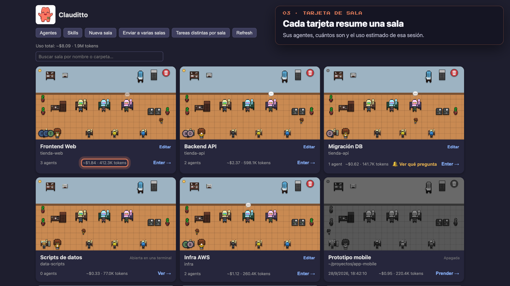

# Clauditto

A pixel-art desktop office for running several [Claude Code](https://claude.com/claude-code)
sessions at once: each session is a room, you see what each one is doing,
reply without losing the thread, and have rooms ask things of each other —
all from one dashboard.



**[Download for Mac / Windows →](#) · [Watch all 15 features on video →](#)**

## Why it exists

I built it because I run several Claude Code sessions at once myself, across
different projects, and needed to see all of them without losing track —
hence the "office" idea, one room per session.

It's a desktop app that runs entirely on your machine: no account, no
telemetry, no server of its own in the middle. The only thing that leaves
your computer is whatever Claude Code itself already sends to Anthropic —
exactly as if you used it from the terminal.

## Features

Full detail, with a video for each one, in
[`docs/features.md`](docs/features.md). In short:

- **Dashboard** with an animated card per session, a search box, and total
  estimated usage.
- **Real embedded terminal**, with `@` to mention an agent from the room's
  roster and `$` for one room to ask something of another (dispatch between
  rooms, with the answer coming back on its own).
- **Notifications** (toast + native OS) for every state change: working,
  blocked, done, failed, or stopped.
- **History**: closed sessions stay right on the dashboard, ready to resume
  with one click.
- **Agent and skill catalogs**, with installation straight from GitHub.
- **MCP server manager**: add/remove MCP servers by pasting the real
  `claude mcp add ...` command, always registered globally for every room.
- **Agent meetings (`/meet`)**: convene a room's assigned agents into a
  structured, multi-round discussion, right from its terminal.
- **Restart room**: reload MCPs and config for a live room without losing
  the conversation — no more deleting and recreating it.
- **Claude Code login and folder-trust prompts**, resolved from inside the
  app instead of sending you to a separate terminal.

## Tech stack

- [Electron](https://www.electronjs.org/) + [electron-vite](https://electron-vite.org/) + TypeScript
- `node-pty` to attach to real `claude` sessions, `better-sqlite3` for local state
- No-framework renderer (DOM by hand) — see `src/renderer/src/core/` (pure logic) and `src/renderer/src/views/` (DOM)
- `vitest` for tests (`npm test`)
- Distribution builds are minified and obfuscated (`javascript-obfuscator`, see `scripts/obfuscatorPlugin.ts`)

## Running it in development

```bash
npm install
npm run dev
```

Requires [Claude Code](https://claude.com/claude-code) already installed
and logged in on your machine — Clauditto is a client for real `claude`
sessions, not a replacement.

```bash
npm test          # run the test suite
npm run dist:mac  # distribution build for Mac (arm64)
npm run dist:win  # distribution build for Windows
```

## Contributing

Stars, issues, and PRs are welcome. See
[`CONTRIBUTING.md`](CONTRIBUTING.md) for how the code is organized and the
workflow.

## Credits

The office pixel art is from the ["Free office pixel art"](https://arlantr.itch.io/free-office-pixel-art)
pack by Arlan_TR.

## License

[MIT](LICENSE)
